# GitSummarize — Developer Playbook 📄

**Who this is for:** any developer (or curious non-developer) who wants to understand, run, or
extend GitSummarize — including people who have never touched AI/LLM/agent code before.
Every technical term is explained the first time it appears, and Section 2 gives you the
absolute basics of "agentic AI" before anything GitSummarize-specific starts.

**A note on accuracy:** this file was written after actually reading every source file described
below (not just the other docs about them — `progress.md` and a couple of code comments turned
out to contain stale claims, called out explicitly in [Section 17](#17-known-issues--documentation-drift)),
and the system was actually run, live, end to end, multiple times against real GitHub repos in
this same working session — a Java/Spring Boot repo (`Employee`, correctly found a planted SQL
injection), a Python/TypeScript repo (`Token-Sentry`), and a TypeScript/Next.js repo
(`Chess_Play`). Two real, reproducible bugs were found and fixed this way (a Mermaid-diagram
parser crash and a missing rate limiter), verified against the *actual* Mermaid.js parser running
in a disposable Node container, not just assumed to work. If you only read one section before
touching code, read [Section 17](#17-known-issues--documentation-drift).

---

## Table of Contents

1. [What Problem Does GitSummarize Solve?](#1-what-problem-does-gitsummarize-solve)
2. [Agentic AI in Plain English (Start Here if You're New)](#2-agentic-ai-in-plain-english-start-here-if-youre-new)
3. [How It Works — The Simple Version](#3-how-it-works--the-simple-version)
4. [Key Concepts Explained (No Jargon)](#4-key-concepts-explained-no-jargon)
5. [Getting Started — Running It Locally](#5-getting-started--running-it-locally)
6. [The Analysis Pipeline — Step by Step](#6-the-analysis-pipeline--step-by-step)
7. [The 5 Top-Level Agents](#7-the-5-top-level-agents)
8. [The 5 Analysis Specialists (Inside "analyze")](#8-the-5-analysis-specialists-inside-analyze)
9. [The Knowledge Graph (Neo4j)](#9-the-knowledge-graph-neo4j)
10. [Semantic Search & the Chat System](#10-semantic-search--the-chat-system)
11. [Real-Time Progress: Celery + Redis + SSE](#11-real-time-progress-celery--redis--sse)
12. [The Backend API — Every Endpoint](#12-the-backend-api--every-endpoint)
13. [The Frontend](#13-the-frontend)
14. [Complete Folder Map](#14-complete-folder-map)
15. [How to Extend GitSummarize](#15-how-to-extend-gitsummarize)
16. [Configuration Reference](#16-configuration-reference)
17. [Known Issues & Documentation Drift](#17-known-issues--documentation-drift)
18. [Quick Reference — Most Important Files](#18-quick-reference--most-important-files)

---

## 1. What Problem Does GitSummarize Solve?

Say you're handed a GitHub link to a codebase you've never seen — a new job, an open-source
project you want to contribute to, a vendor's repo you need to audit. Before you can do anything
useful, you have to answer a pile of questions: What language/framework is this? What's the
overall architecture? What API endpoints exist? What does the database schema look like? Are
there obvious security holes? Which files matter and which are boilerplate?

Normally that means hours of manually opening files, grepping for patterns, and building a mental
model from scratch.

**GitSummarize automates that first pass.** Give it a GitHub URL, and it clones the repo,
actually *parses* the code (not just guesses from file names), and produces:

- An executive summary in plain English
- The detected tech stack (languages, frameworks, database, cache, etc.)
- An architecture report (style, layers, design patterns, concerns)
- A full API endpoint inventory
- A database schema breakdown (entities, columns, relationships)
- A security report (OWASP-style findings with severity and file/line references)
- 5 Mermaid.js diagrams (architecture flowchart, class diagram, sequence diagrams, ER diagram,
  dependency graph)
- A **queryable knowledge graph** (Neo4j) of files/functions/classes and their relationships
- A **chatbot** you can ask follow-up questions, grounded in the actual code (not hallucinated)

It's the same "decompose a hard problem into narrow specialist steps, then merge" idea used by
many agentic-AI code tools: instead of one LLM call trying to do everything at once, GitSummarize
runs **5 focused specialist agents** (architecture, backend/API, frontend, database, security),
each looking at a curated slice of the codebase, then a diagram agent and a documentation agent
turn all of that into the final report.

---

## 2. Agentic AI in Plain English (Start Here if You're New)

You do not need any AI background to work on this codebase. Here is the entire mental model,
built up from zero.

### What is an LLM?

An **LLM (Large Language Model)** — like GPT, Llama, or Qwen — is software that has read an
enormous amount of text and learned to predict "what word plausibly comes next." Ask it a
question, and it generates an answer one word at a time based on that pattern. It has no memory
between separate calls unless you explicitly hand it the previous conversation as text. It
cannot browse a repository or run code by itself — it can only read whatever text you put
directly into its request (the **prompt**) and reply with text.

### What makes something "agentic"?

A plain chatbot call is: *you send one prompt in, you get one answer out, done.*

An **agent** is different in one specific way: **the AI's output — or a sequence of steps built
around it — controls what happens next**, instead of one human reading every reply and manually
deciding the next action.

**Important honesty check for this specific repo:** GitSummarize's own pipeline is **not**
agentic in the strict "the AI decides what to do next" sense. It's a fixed, predetermined
sequence of 5 steps (clone → parse → analyze → diagram → document, always in that exact order,
never skipped or reordered — see [Section 6](#6-the-analysis-pipeline--step-by-step)). Nothing in
this repo does tool-calling or a ReAct-style reasoning loop. What makes it reasonably described as
"agentic AI" in the loose, common sense is: (1) it's built as a graph of discrete steps using
**LangGraph** (a library purpose-built for agentic systems), (2) several of those steps are
themselves "an LLM call with a narrow job," and (3) the whole system is commonly categorized
alongside other "AI coding agents." But if you came here expecting an AI that decides on its own
which files to open or which questions to ask — that's not what this pipeline does. The one place
an LLM's own JSON output does directly determine what gets stored (which diagrams exist, which
security findings get flagged) is real, but the *sequence of steps* itself is hardcoded.

### Why split the work into 5 narrow specialists instead of one big prompt?

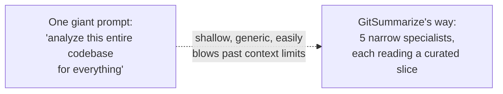

Asking one LLM call to "figure out the architecture, the API, the database schema, the security
posture, and the frontend structure, all at once, for a whole codebase" runs into two real
problems: the model's attention spreads thin across too many concerns, and most real repos are
far too large to paste entirely into one prompt anyway. GitSummarize's design instead **ranks and
selects a small, relevant slice of files for each concern** (e.g. the security specialist only
sees files whose names/paths suggest auth, secrets, or config) and asks one narrow question per
specialist. This is the same "decompose → specialize → synthesize" idea as tools like ArchFox use
for PR review, just applied to whole-repo analysis instead of PR diffs.

### The rest of the vocabulary, in one paragraph each

- **Tool / function calling:** a plain function an LLM is told it's allowed to invoke by name.
  **Not used anywhere in GitSummarize** — every LLM call here is a single request/response with a
  JSON-shaped instruction, no back-and-forth tool loop.
- **RAG (Retrieval-Augmented Generation):** before asking the LLM a question, first search a
  database for relevant information and paste it into the prompt. This is exactly how
  GitSummarize's chat feature works (see [Section 10](#10-semantic-search--the-chat-system)):
  it searches stored code chunks by meaning, then hands the LLM only the relevant ones.
- **Embedding:** a way to turn a chunk of text into a list of numbers (a "vector") such that texts
  with similar *meaning* produce similar numbers. GitSummarize computes these **locally** with a
  small open-source model (`BAAI/bge-small-en-v1.5`, via `sentence-transformers`) — no external
  API call, no cost, but it does mean the embedding step runs on CPU inside the same containers.
- **Vector database:** a database built to store embeddings and quickly find the ones most
  similar to a new query embedding. GitSummarize uses **Qdrant**.
- **Graph database:** a database that stores *relationships* between things as first-class data —
  "file A defines function B, function B imports module C" — instead of just rows in a table.
  GitSummarize uses **Neo4j** (see [Section 9](#9-the-knowledge-graph-neo4j)), with **no
  in-memory fallback** — if Neo4j is unreachable, the graph-related features degrade gracefully
  (empty graph, warning logged) rather than crashing, but nothing substitutes for it.
- **AST (Abstract Syntax Tree) / Tree-sitter:** when you write `def greet(name): return "Hi " +
  name`, a parser can turn that into a tree: "function definition → name: greet → parameter: name
  → return statement → …". This lets software understand code *structurally* instead of treating
  it as a plain string — e.g. reliably finding "every function in this file and its exact line
  range," which a regex would get wrong constantly. **Tree-sitter** is the specific library
  GitSummarize uses, with dedicated parsers for Python, TypeScript, JavaScript, Java, Go, Rust,
  C#, and PHP.
- **LangGraph:** the Python library GitSummarize uses to wire multiple steps (each a plain Python
  function called a **node**) into an explicit, linear flowchart, with a shared, typed dictionary
  of data (the **state**) that every node can read from and add to as it runs — see
  [Section 6](#6-the-analysis-pipeline--step-by-step).
- **Celery / task queue:** a system for running slow work (here, a full repo analysis, which can
  take minutes) in a background process instead of making an HTTP request wait. The API responds
  instantly with "queued," and a separate **worker** process picks up the job later.
- **SSE (Server-Sent Events):** a one-way, long-lived HTTP connection the server uses to push
  updates to the browser as they happen — this is how the frontend's live progress screen gets
  "clone done… parsing… analyzing…" updates in real time without polling every second.
- **Fallback chain (LLM):** if the primary model fails (rate-limited, times out, errors), retry
  the *same request* against a second, then a third model, instead of failing outright. This is
  central to how GitSummarize survives Groq's free-tier rate limits — see
  [Section 7](#7-the-5-top-level-agents) and [Section 16](#16-configuration-reference).

If all of that made sense, you now know everything you need to read the rest of this document
comfortably — nothing past this point assumes more AI background than what's above.

---

## 3. How It Works — The Simple Version

```
You paste a GitHub URL into the web UI
        |
        v
API creates a Repository + Analysis row, queues a background job, replies instantly ("queued")
        |
        v
A Celery worker picks up the job and runs the 5-step pipeline:
    1. Clone the repo (GitPython, shallow clone)
    2. Parse every source file into an AST (Tree-sitter) + build a knowledge graph + embed code chunks
    3. Run 5 specialist analyses, one after another:
         - Architecture   - Backend/API   - Frontend   - Database   - Security
    4. Generate 5 Mermaid diagrams from the analysis results
    5. Write the final Markdown docs + executive summary
        |
        v
Each step publishes a progress event over Redis; the browser shows it live via SSE
        |
        v
You land on a results dashboard: diagrams, docs, the knowledge graph, and a chatbot
```

### System Overview Diagram

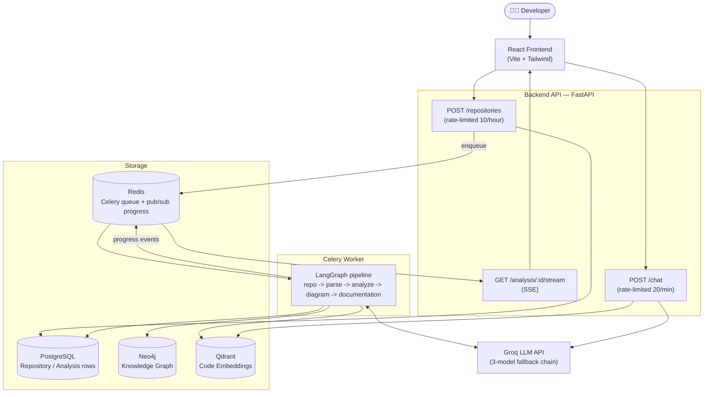

---

## 4. Key Concepts Explained (No Jargon)

This is a quick-reference glossary in addition to [Section 2](#2-agentic-ai-in-plain-english-start-here-if-youre-new).
Each entry: the everyday analogy first, then what it actually means in GitSummarize.

| Term | Everyday analogy | What it means here |
|---|---|---|
| **LLM** | A very well-read assistant who predicts the next word | GitSummarize calls **Groq's** hosted models — primary `openai/gpt-oss-120b`, falling back to `openai/gpt-oss-20b`, then `qwen/qwen3.8-27b` (see [Section 17, item 1](#17-known-issues--documentation-drift) — one code comment claims these are OpenRouter models; they are not) |
| **Node (LangGraph)** | One station on a factory assembly line | A plain async Python function: `(state) -> dict of updates`. GitSummarize's pipeline has 5 of them |
| **State (LangGraph)** | A shared whiteboard every station can read and write to | `AnalysisState`, a `TypedDict` in `backend/agents/state.py`, carried through the whole pipeline |
| **Embedding** | Converting a code snippet into "GPS coordinates of meaning" | A 384-number vector per parsed function/class, produced locally by `BAAI/bge-small-en-v1.5` — no API call, runs on CPU |
| **Vector database** | A filing cabinet organized by "vibe" instead of alphabetically | **Qdrant**, storing code chunk text + its embedding, queried for "what's most similar in meaning to this chat question" |
| **Graph database** | A detective's string-and-pushpin board connecting suspects | **Neo4j**, storing `File --DEFINES--> Function`, `File --IMPORTS--> File` as real, queryable edges |
| **AST** | A sentence diagram from English class, but for code | A tree structure showing "this is a function, this is its parameters, this is its body" |
| **Tree-sitter** | The tool that draws that sentence diagram | A parsing library GitSummarize uses for Python, TS, JS, Java, Go, Rust, C#, PHP |
| **RAG** | An open-book exam | Search stored code chunks by meaning first, then hand the LLM only the relevant ones before it answers a chat question |
| **Celery / worker** | A restaurant's kitchen — the front counter takes your order instantly, the kitchen cooks it in the background | The API replies "queued" in milliseconds; a separate worker process does the actual multi-minute analysis |
| **Redis (here)** | Two jobs at once: the kitchen's order tickets, and the intercom announcing "order 12 is ready" | Both the Celery task queue/broker **and** the pub/sub channel the worker uses to push live progress events |
| **SSE (Server-Sent Events)** | A radio station broadcasting updates, vs. you calling every 3 seconds to ask "done yet?" | `GET /analysis/{id}/stream` keeps one HTTP connection open and pushes `step`/`done`/`error` events as they happen |
| **Fallback chain** | Calling a backup mechanic when your first one doesn't pick up | If the primary Groq model is rate-limited, LangChain's `.with_fallbacks()` automatically retries the same prompt on 2 backup models |
| **Mermaid diagram** | A flowchart written as text, not drawn by hand | A small text language (`flowchart TD`, `classDiagram`, …) that renders into a real diagram in the browser — this is what powers all 5 generated diagrams |
| **Knowledge graph** | A map of "who's connected to whom," not just a list of names | Files, functions, classes, and API endpoints as graph nodes, with `DEFINES`/`IMPORTS` edges between them, queried live in the results UI |

---

## 5. Getting Started — Running It Locally

### Prerequisites

- Docker + Docker Compose (this is the intended way to run everything — 7 services)
- A free Groq API key from https://console.groq.com/keys

### Step 1 — Create your `.env` file

```env
GROQ_API_KEY=gsk_your_groq_key_here
# Everything else has a working default in backend/config.py — see Section 16
```

### Step 2 — Bring up the full stack

```bash
docker compose build
docker compose up -d
```

This starts all 7 services: `postgres` (5432), `neo4j` (7474 browser / 7687 bolt), `qdrant`
(6333), `redis` (6379), `api` (8000), `worker`, `flower` (5555, Celery monitoring UI), and
`frontend` (3000). The `api` container runs `alembic upgrade head` automatically on startup
before starting Uvicorn — no manual migration step needed.

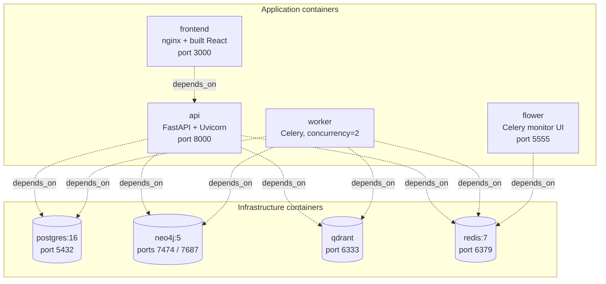

### Step 3 — Confirm it's healthy

```bash
curl http://localhost:8000/health
# {"status":"ok","version":"0.1.0"}
```

### Step 4 — Use it

Open **http://localhost:3000**, paste a GitHub URL (must be a public `https://github.com/owner/repo`
URL — validated client- and server-side), and submit. You'll land on a live progress page, then a
results dashboard with diagrams, docs, the knowledge graph, and a chat panel once analysis
completes (usually a few minutes, depending on repo size and current Groq rate-limit headroom).

**Note on rate limits:** submitting a repo or re-analyzing is capped at **10 requests/hour per
client IP**, and chat is capped at **20 messages/minute per client IP** (see
[Section 12](#12-the-backend-api--every-endpoint)) — this exists specifically because **there is
no authentication anywhere in this API** (see [Section 17](#17-known-issues--documentation-drift)),
so IP-based rate limiting is the one real guard against runaway LLM cost from a single client.

---

## 6. The Analysis Pipeline — Step by Step

The whole pipeline is defined in **`backend/agents/graph.py`** using LangGraph. It is
deliberately simple: 5 nodes, in a single fixed line, no branching:

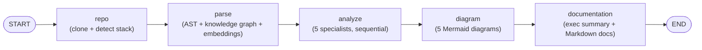

There is **no conditional routing** — `add_conditional_edges` is never called anywhere in this
codebase. Every node is wrapped by `_make_safe_node()` (`graph.py` lines 55-64), which catches any
uncaught exception and turns it into `{"errors": [...]}` on the shared state, rather than crashing
the whole run. This is a safety net, not a retry — the node itself doesn't re-run; retries only
happen *inside* `analyze_agent` for its 5 sub-agents (up to 3 attempts each, with 2s/5s/10s
backoff — see [Section 8](#8-the-5-analysis-specialists-inside-analyze)).

The **state** flowing through all 5 nodes is `AnalysisState`, a `TypedDict` in
`backend/agents/state.py` — think of it as one big dictionary that starts almost empty and gets
filled in as each node runs: `repo_url` in, then `local_path`/`languages`/`frameworks` after
`repo`, then `parsed_files`/`tech_stack` after `parse`, then `architecture_report`/`api_report`/
`database_report`/`security_report`/`frontend_report`/`module_breakdown` after `analyze`, then
`diagrams` after `diagram`, then `executive_summary`/`markdown_docs` after `documentation`. The
only field with a LangGraph *reducer* (meaning: values accumulate across nodes instead of the
last write winning) is `errors`, via `Annotated[list[str], operator.add]`.

### How the shared state grows, stage by stage

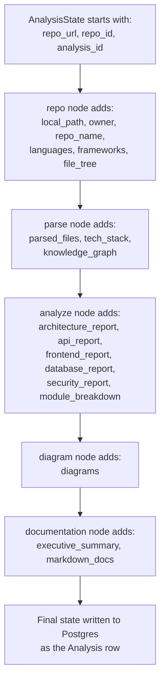

**Two different entry points exist**, and it matters which one runs in production:
`run_analysis()` in `graph.py` is a simple one-shot `graph.ainvoke(...)`, useful for tests/scripts.
The **actual Celery worker** (`backend/workers/tasks.py`) does **not** call `run_analysis()` — it
calls `graph.astream(initial_state, stream_mode="updates")` directly so it can intercept each
node's output as it completes and publish a progress event to Redis before moving to the next
node (see [Section 11](#11-real-time-progress-celery--redis--sse)).

---

## 7. The 5 Top-Level Agents

All live under `backend/agents/`.

### `repo_agent.py` — clone and fingerprint the repo

Clones using **GitPython** (`import git`), not raw `subprocess` calls, with a shallow clone
(`depth=1`, so history isn't downloaded — this analyzes the current state of the repo, not its
history). If a previous clone of the same repo already exists on disk, it cleans and pulls
instead of re-cloning from scratch, falling back to a full delete+re-clone if that fails.

It then walks the file tree (skipping `.git`, `node_modules`, `__pycache__`, `venv`, `dist`,
`build`, etc.), detects **languages** by file extension, and detects **frameworks** by looking for
telltale files — `next.config.js` → Next.js, `pom.xml` → Spring Boot, `artisan` → Laravel, and
similar signals for others. This is a fast, cheap, no-LLM step; it's what makes the "languages"/
"frameworks" chips you see on the homepage repo list.

### `parsing_agent.py` — build the AST, the knowledge graph, and the embeddings

Filters the file tree down to files with a recognized language extension, under 512KB, capped at
2000 files total (real-world safety limits for very large repos). Each surviving file goes through
`get_parser_for(path)`, which dispatches to the right Tree-sitter parser (`backend/parsers/`, one
per language) to extract functions/classes/imports with exact line ranges.

From those parsed files, this same node does two more things, both wrapped in try/except so a
failure only logs a warning rather than failing the whole analysis:
1. **Builds and persists the knowledge graph** to Neo4j (`KnowledgeGraphBuilder`, see
   [Section 9](#9-the-knowledge-graph-neo4j)) — yes, the graph is built during `parse`, not during
   `analyze`, which is a little counter-intuitive if you're skimming the pipeline name only.
2. **Chunks and embeds the code**, storing vectors in Qdrant (see
   [Section 10](#10-semantic-search--the-chat-system)) — this is what later powers the chatbot.

It also infers a coarse `tech_stack` dict (frontend/backend/orm/cache/database) purely by
substring-matching the collected import statements — a fast heuristic, not an LLM call.

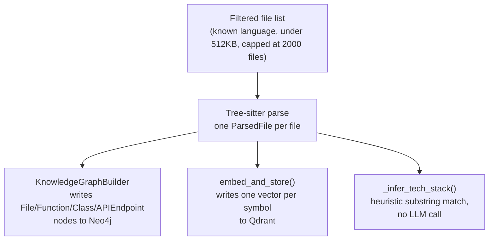

The `parse` node does 3 things with the same parsed output — this is worth seeing side by side
since the section names ("parse," "analyze") make it easy to assume the knowledge graph and
embeddings are built later, during `analyze`. They aren't.

### `analyze_agent.py` — the orchestrator (makes zero LLM calls itself)

This node's entire job is to run the 5 specialist sub-agents ([Section 8](#8-the-5-analysis-specialists-inside-analyze))
**one after another, in a fixed order**, each with up to 3 retry attempts (2s, 5s, 10s backoff) if
it throws. The module imports `asyncio` but never calls `asyncio.gather` — this is intentional,
not an oversight: running all 5 in parallel would burst well past Groq's free-tier
requests-per-minute limit, so they're deliberately serialized. This is the main reason a full
analysis takes a few minutes rather than under one.

### `diagram_agent.py` — one LLM call, five diagrams, with a real fallback

Makes a single LLM call asking for a JSON object containing all 5 Mermaid diagram strings at
once, built from the architecture/API/database reports already gathered. If that call throws for
any reason, it falls back to `_generate_fallback_diagrams()` — real diagrams built
**programmatically** (no LLM) directly from the structured report data, so you still get diagrams
even during an LLM outage, just simpler ones.

Every diagram string — LLM-generated or fallback — passes through `_sanitize_mermaid()`, which
fixes 3 real, previously-observed LLM output mistakes: a stray leading `mermaid` text line left
over from a nested code fence, a stray `>` after a closing `|` in edge labels, and an unescaped
`(` inside an unquoted node label (which breaks Mermaid's parser — it reads `(` as the start of a
new node shape). This exact bug — diagrams failing to render because of that last issue — was
found and fixed live in this session; see [Section 17](#17-known-issues--documentation-drift) for
the full story and how it was verified against the real Mermaid.js parser.

### `documentation_agent.py` — 2 LLM calls, 3 templated docs

Makes exactly 2 LLM calls: one for the prose `executive_summary`, one for an `onboarding.md`
guide. The other 4 Markdown documents it returns (`architecture.md`, `api.md`, `database.md`,
`security.md`) involve **no LLM call at all** — they're built by directly templating the
structured report dicts already sitting in state. This keeps those 4 docs perfectly consistent
with the structured data shown elsewhere in the UI (no risk of the LLM "re-describing" the API
report differently from the actual `api_report` JSON).

---

## 8. The 5 Analysis Specialists (Inside "analyze")

Each of these lives in its own file under `backend/agents/`, and each is context-limited on
purpose — Groq's free tier caps at roughly 12,000 tokens/minute, so every specialist ranks and
selects at most 10 files, 800 characters each, 6,000 characters total (see
`backend/llm/context.py::build_context()`), rather than trying to stuff in the whole repo.

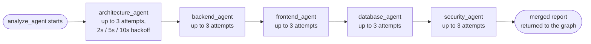

Every arrow above runs **one at a time, never in parallel** — this is the concrete picture behind
the "sequential to avoid bursting Groq's rate limit" note in [Section 7](#7-the-5-top-level-agents).
A failure in one specialist's 3 attempts doesn't stop the chain; `analyze_agent` moves on to the
next specialist regardless, so a security-analysis failure never blocks the architecture report
you already got.

| Specialist | Fills in (`AnalysisState` field) | What it looks at | LLM used |
|---|---|---|---|
| `architecture_agent.py` | `architecture_report`, `module_breakdown`, `design_patterns` | The full file-tree summary + a symbol index (classes/functions per file) | The **full 3-model fallback chain** (`get_router().get(TaskType.ANALYZE)`) — the only specialist that gets this |
| `backend_agent.py` | `api_report` | Files matching keywords like `route`/`controller`/`endpoint`/`handler`/`api` with backend extensions | A single non-fallback fast model (`get_fast_llm()`) |
| `frontend_agent.py` | `frontend_report` | Files matching `component`/`page`/`view`/`store`/`hook` with `.tsx`/`.jsx`/`.vue`/`.svelte` | Same fast model |
| `database_agent.py` | `database_report` | Files matching `model`/`schema`/`migration`/`entity`/`orm` plus `.prisma`/`.sql` | Same fast model |
| `security_agent.py` | `security_report` | Files matching `auth`/`password`/`token`/`secret`/`jwt`/`cors`/`.env`/config files | Same fast model, prompted as an "OWASP, SAST expert" |

Two things worth knowing about this table if you're extending it: **only `architecture_agent`
gets the full fallback chain** — the other 4 use a single model with no automatic fallback if it
fails (they do still get their own 3-attempt retry loop from `analyze_agent`, just against the
same one model each time, not 3 different models). And **`frontend_report` never makes it into
the final `/analysis/{id}/result` API response** — it's computed and stored in the database, but
silently dropped when the API assembles the response object (see
[Section 17](#17-known-issues--documentation-drift)) — so if you're building a UI feature around
it, check the database directly, not the REST response.

If a specialist finds zero matching files (e.g. a repo genuinely has no database layer),
`backend_agent`/`frontend_agent`/`database_agent`/`security_agent` return an empty/`None` report
directly — **no LLM call happens at all** in that case, saving both time and quota.

---

## 9. The Knowledge Graph (Neo4j)

Built during the `parse` node by `KnowledgeGraphBuilder` (`backend/knowledge_graph/builder.py`),
persisted to Neo4j, and served live to the frontend's graph view via
`GET /repositories/{repo_id}/graph`.

**What's actually built today:** one `File` node per parsed file, one `Function`/`Class` node per
parsed symbol, a `DEFINES` edge from file → symbol, and (heuristically, by name pattern — e.g.
functions starting with `get_`/`post_`/`handle_` or ending in `Controller`/`Handler`/`Route`) an
`APIEndpoint` node with its own `DEFINES` edge. `IMPORTS` edges connect files to the files they
import, resolved per-language (separate resolvers for Python, TS/JS, Java, Go, Rust import
syntax).

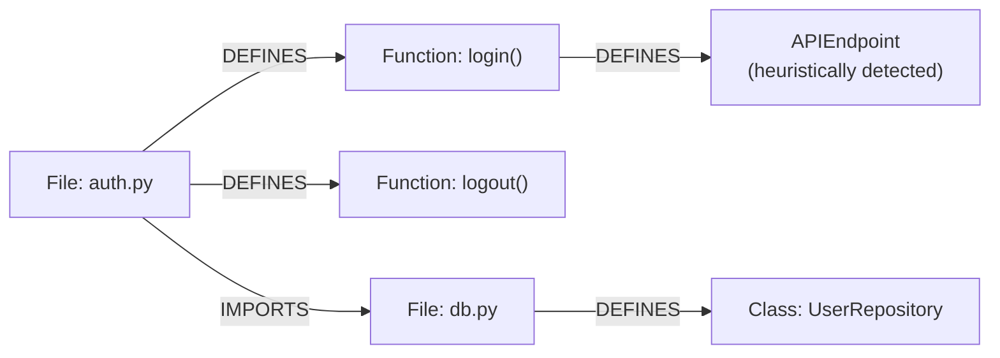

**Worth knowing before you build on this:** `backend/knowledge_graph/models.py` also *declares*
node types `Module`, `DBTable`, `Service` and relationship types `CALLS`, `EXTENDS`, `IMPLEMENTS`,
`USES`, `QUERIES`, `BELONGS_TO` — but no code anywhere actually creates them yet. Only
`File`/`Function`/`Class`/`APIEndpoint` nodes and `DEFINES`/`IMPORTS` edges are ever populated. If
you want real call-graph edges (`CALLS`) or class-hierarchy edges (`EXTENDS`), that's a real,
well-scoped feature to add — the enum and Cypher query shape already exist, just no producer
writes them.

The node/edge writer uses `MERGE` (create-if-not-exists) rather than `CREATE`, so re-running
analysis on the same repo doesn't create duplicates, and relationship types are checked against a
hardcoded whitelist before being interpolated into Cypher (since Neo4j's driver doesn't support
parameterizing relationship *types*, only property values — the whitelist is what prevents this
from being a Cypher-injection point).

### The full write-then-read path, end to end

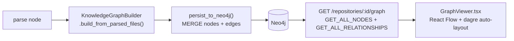

This is the same path the earlier graph-layout fix touched — the dagre auto-layout step is what
replaced the original rigid 3-column node arrangement with a real, edge-aware layout.

---

## 10. Semantic Search & the Chat System

### How embeddings get created

Also during `parse`, `backend/embeddings/pipeline.py` chunks each parsed file **by symbol**, not
by naive line-count splitting: one chunk per function/class, using its exact `start_line`/
`end_line` from the AST, prefixed with a small `# function: name` comment for context. Files with
no parsed symbols fall back to one whole-file chunk. Each chunk is embedded locally via
`BAAI/bge-small-en-v1.5` (`sentence-transformers`, 384-dimensional vectors, no external API call)
and stored in Qdrant with metadata (file path, symbol name, line range).

**Known trade-off, not a bug:** the embedding call is synchronous and blocks the event loop for
its duration — acceptable for a single-repo-at-a-time analysis pipeline running inside a Celery
worker process, but worth knowing if you ever try to run many analyses concurrently in the same
worker.

### How the chatbot answers a question

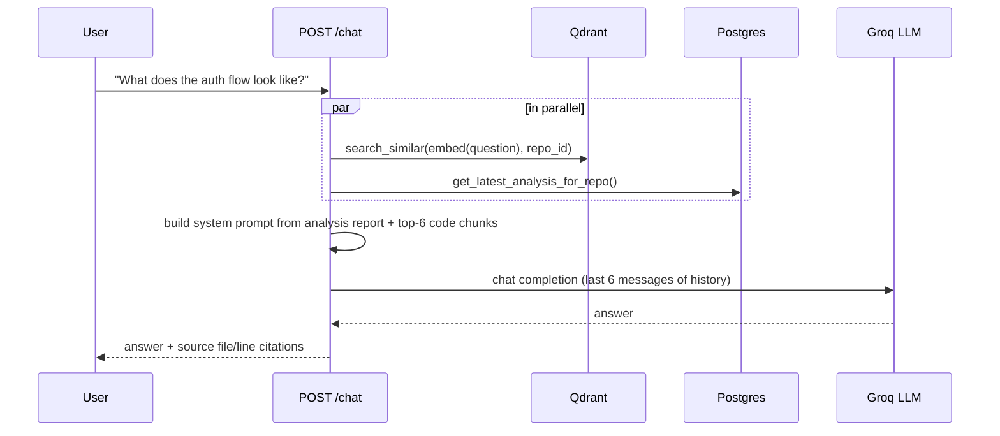

The two lookups (Qdrant search, latest analysis fetch) run **in parallel** via `asyncio.gather`,
not sequentially. Chat history is truncated to the last 6 messages (3 back-and-forth turns) to
stay inside Groq's free-tier token budget. If the LLM call fails for any reason, the endpoint
returns a clean `503` with the message "LLM temporarily unavailable — all models are
rate-limited. Try again in a moment." — this is a deliberate, already-correct piece of error
handling, not a bug (see [Section 17](#17-known-issues--documentation-drift) for why this matters
if you ever see a "chat failed" report from a user).

---

## 11. Real-Time Progress: Celery + Redis + SSE

Analysis is slow (LLM calls, cloning, parsing) — too slow to make an HTTP request wait on. So
`POST /repositories` replies in milliseconds with `{"message": "Analysis queued successfully"}`
and hands the real work to a Celery worker.

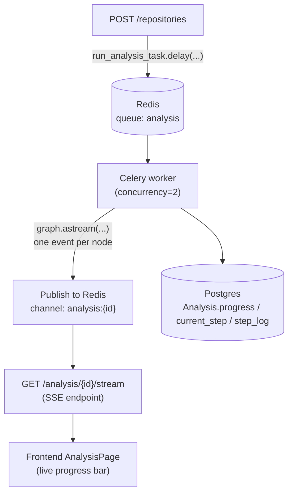

The worker task also writes its own progress to Postgres (`Analysis.progress`, `current_step`,
`step_log`) as a durable record, independent of Redis — this is why the SSE endpoint can "replay"
past events from Postgres first (for a browser tab that connects late or refreshes) before
switching to live Redis pub/sub for what's still to come, plus a 15-second heartbeat so the
connection doesn't get closed by an idle-timeout proxy while waiting on a slow LLM call.

A subtlety worth knowing if you touch this: the Celery task explicitly calls `reset_engine()`
(clearing the module-level SQLAlchemy async engine singleton) before its own `asyncio.run(...)`
call — without this, the engine's connections would be bound to a *previous* asyncio event loop
that Celery has already closed, producing a "Future attached to a different loop" error.

---

## 12. The Backend API — Every Endpoint

All mounted under `/api/v1`, plus an unprefixed `/health`.

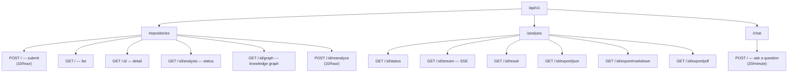

**`/repositories`** (`backend/api/routes/repositories.py`):
| Method + Path | Purpose |
|---|---|
| `POST /` | Submit a repo URL, queue analysis. **Rate-limited 10/hour/IP.** |
| `GET /` | Paginated list of all submitted repos. |
| `GET /{repo_id}` | Single repo detail. |
| `GET /{repo_id}/analysis` | Latest analysis status for a repo. |
| `GET /{repo_id}/graph` | Knowledge graph nodes/edges from Neo4j. Returns empty arrays (never a 500) if Neo4j is unreachable. |
| `POST /{repo_id}/reanalyze` | Wipe the Neo4j graph, re-queue analysis. **Rate-limited 10/hour/IP.** |

**`/analysis`** (`backend/api/routes/analysis.py`):
| Method + Path | Purpose |
|---|---|
| `GET /{id}/status` | Just the status/progress fields. |
| `GET /{id}/stream` | SSE live progress (see [Section 11](#11-real-time-progress-celery--redis--sse)). |
| `GET /{id}/result` | The full `AnalysisResult` — diagrams, reports, docs (note: `frontend_report` is dropped, see [Section 17](#17-known-issues--documentation-drift)). |
| `GET /{id}/export/json` | Export as JSON. |
| `GET /{id}/export/markdown` | Export the stored Markdown docs. |
| `GET /{id}/export/pdf` | Export as PDF (hand-rolled Markdown→PDF renderer via `fpdf2`). |

**`/chat`** (`backend/api/routes/chat.py`):
| Method + Path | Purpose |
|---|---|
| `POST /` | Ask a question about an analyzed repo. **Rate-limited 20/minute/IP.** |

Rate limiting is implemented with `slowapi`, keyed by client IP (`backend/core/limiter.py`), and
requires Uvicorn's `--proxy-headers` flag (set in `docker-compose.yml`) to see the real client IP
through the frontend's nginx reverse proxy rather than nginx's own container IP for every request.

---

## 13. The Frontend

React 18 + Vite + TailwindCSS. `App.tsx` is the entire router: 3 routes (`/` → `HomePage`,
`/analysis/:analysisId` → `AnalysisPage`, `/results/:repoId` → `ResultsPage`), wrapped in a React
Query provider (30s stale time) and a `sonner` toast provider. All API calls go through
`frontend/src/api/client.ts` (a single Axios instance, `baseURL: "/api/v1"`).

| Page/Component | Job |
|---|---|
| `pages/HomePage.tsx` | Repo submission form + list of previously analyzed repos |
| `pages/AnalysisPage.tsx` | Live progress view, driven by the `useAnalysisStream` SSE hook |
| `pages/ResultsPage.tsx` | Main dashboard — wires together diagrams, docs, chat, and the graph view |
| `components/RepositoryForm.tsx` | The GitHub URL submit form |
| `components/AnalysisProgress.tsx` | Renders each pipeline step with an icon (Clone/Parse/Analyze/Diagram/Document) |
| `components/DiagramViewer.tsx` | Renders the 5 Mermaid diagrams client-side, with its own defensive `sanitizeMermaid()` mirroring the backend's fix |
| `components/DocumentationViewer.tsx` | Renders the Markdown docs (`react-markdown` + GFM) with export buttons |
| `components/ChatInterface.tsx` | The chat panel |
| `components/GraphViewer.tsx` | Knowledge graph visualization — React Flow (`@xyflow/react`) + `dagre` for real auto-layout |

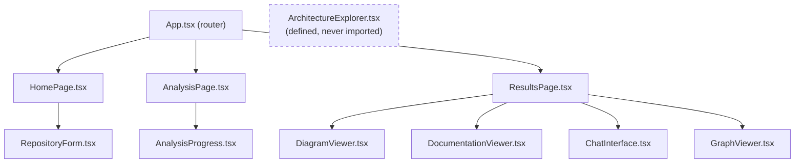

`ArchitectureExplorer.tsx` is drawn disconnected above on purpose — it exists and is exported but
has **zero import sites** anywhere in the frontend; it's dead code, not currently reachable from
the UI (see [Section 17](#17-known-issues--documentation-drift)).

---

## 14. Complete Folder Map

```
backend/
├── main.py                      FastAPI app, lifespan, CORS, routers, /health
├── config.py                    Settings (pydantic-settings) — see Section 16
├── agents/
│   ├── graph.py                 LangGraph StateGraph builder + run_analysis()
│   ├── state.py                 AnalysisState TypedDict
│   ├── repo_agent.py            clone + detect languages/frameworks
│   ├── parsing_agent.py         AST parse + knowledge graph + embeddings
│   ├── analyze_agent.py         orchestrates the 5 specialists below (sequential)
│   ├── architecture_agent.py    │
│   ├── backend_agent.py         │ the 5 specialists
│   ├── frontend_agent.py        │ (Section 8)
│   ├── database_agent.py        │
│   ├── security_agent.py        │
│   ├── diagram_agent.py         5 Mermaid diagrams (+ non-LLM fallback)
│   └── documentation_agent.py   exec summary + 4 templated Markdown docs
├── api/
│   ├── deps.py                  get_session dependency
│   └── routes/{repositories,analysis,chat}.py
├── core/{exceptions,limiter,logging}.py
├── database/{postgres,neo4j,qdrant}.py
├── embeddings/pipeline.py       chunking + embedding + Qdrant upsert
├── knowledge_graph/{builder,models,queries}.py
├── llm/{client,router,context,utils}.py
├── models/
│   ├── db/{base,repository,analysis}.py     SQLAlchemy ORM models
│   └── schemas/{repository,analysis}.py     Pydantic request/response models
├── parsers/{base,python_parser,typescript_parser,java_parser,go_parser,rust_parser,csharp_parser,php_parser}.py
├── services/{analysis_service,repository_service,export_service}.py
└── workers/{celery_app,tasks}.py

frontend/src/
├── main.tsx, App.tsx
├── api/client.ts                Axios client, one function per endpoint
├── types/index.ts                shared TS interfaces
├── hooks/{useAnalysis,useAnalysisStream,useChat}.ts
├── pages/{HomePage,AnalysisPage,ResultsPage}.tsx
└── components/{RepositoryForm,AnalysisProgress,DiagramViewer,
               DocumentationViewer,ChatInterface,GraphViewer,ArchitectureExplorer}.tsx

tests/                            24 tests across 7 files — see Section 17 for coverage gaps
docker-compose.yml                7 services: postgres, neo4j, qdrant, redis, api, worker, flower, frontend
.github/workflows/ci.yml          backend (ruff+mypy+pytest), frontend (tsc+build), docker (build-verify)
```

---

## 15. How to Extend GitSummarize

**Add a 6th analysis specialist** (e.g. a "testing coverage" agent): copy the shape of
`backend/agents/security_agent.py` — it's the smallest, cleanest example (context selection via
`build_context()`, one LLM call via `get_fast_llm()`, JSON parsing via `extract_json`, a Pydantic
schema in `models/schemas/analysis.py`, a non-LLM fallback for when the LLM call throws). Add its
call into `analyze_agent.py`'s sequential loop, add its output field to `AnalysisState`
(`state.py`), and add a matching field to `AnalysisResult` if it should appear in the API
response.

**Add a new relationship type to the knowledge graph** (e.g. real `CALLS` edges): the enum already
exists in `backend/knowledge_graph/models.py`; you need a producer. The natural place is inside
`KnowledgeGraphBuilder.build_from_parsed_files()` (`backend/knowledge_graph/builder.py`) — for
each parsed function body, you'd need the Tree-sitter parser to also expose call-site information
(currently the parsers extract symbol *definitions*, not call sites within a function body — that
would be new parser work too, not just a graph-builder change).

**Add a new language:** add a new file under `backend/parsers/` following the shape of
`python_parser.py`, register its extension → parser mapping (wherever `get_parser_for()` dispatches
— check `backend/parsers/base.py` for the registry), and add its file extension to
`repo_agent.py`'s `_ext_to_lang` map so it's actually detected as a "language" on the repo card.

**Change which LLM provider is used:** update `GROQ_API_KEY`/`GROQ_MODEL`/`GROQ_FALLBACK_1`/
`GROQ_FALLBACK_2` in `.env` (see [Section 16](#16-configuration-reference)). Do **not** trust
`backend/llm/router.py`'s own docstring here — it describes OpenRouter, which the real code
(`backend/llm/client.py`) doesn't actually call; see
[Section 17](#17-known-issues--documentation-drift).

---

## 16. Configuration Reference

All settings load via `backend/config.py` (`pydantic-settings`, reads `.env`).

| Setting | Default | Notes |
|---|---|---|
| `groq_api_key` | *(required, no default)* | Only real LLM provider actually used |
| `groq_model` | `openai/gpt-oss-120b` | Primary model |
| `groq_fallback_1` | `openai/gpt-oss-20b` | Used by all 4 non-architecture specialists as their *only* model |
| `groq_fallback_2` | `qwen/qwen3.8-27b` | Third link in the architecture specialist's fallback chain |
| `groq_base_url` | `https://api.groq.com/openai/v1` | |
| `openrouter_*` | present | **Configured but never actually called anywhere in the codebase** — see Section 17 |
| `database_url` | *(required, no default)* | Postgres async connection string |
| `neo4j_uri` / `neo4j_user` / `neo4j_password` | `bolt://localhost:7687` / `neo4j` / `gitsummarize_secret` | |
| `qdrant_host` / `qdrant_port` | `localhost` / `6333` | |
| `redis_url` | `redis://localhost:6379/0` | |
| `celery_broker_url` / `celery_result_backend` | `redis://localhost:6379/0` / `.../1` | Separate DB index for broker vs. result backend |
| `embedding_model` | `BAAI/bge-small-en-v1.5` | Runs locally via `sentence-transformers`, no API key needed |
| `embedding_dimension` | `384` | Must match the model's actual output size |
| `cors_origins` | `["http://localhost:3000"]` | Accepts CSV or JSON-array string |
| `repo_clone_base_path` | `/tmp/gitsummarize/repos` | |
| `secret_key` | `change-me-in-production` | **Not actually used to protect anything** — see Section 17, there's no auth in this app |

All 7 Docker Compose services and their ports: `postgres` 5432, `neo4j` 7474/7687, `qdrant` 6333,
`redis` 6379, `api` 8000, `flower` 5555 (Celery monitoring), `frontend` 3000.

---

## 17. Known Issues & Documentation Drift

This section exists because this repo has a couple of stale doc claims and a couple of
never-wired code paths that don't match the running system. Each item below was verified directly
against the source, not assumed from another document.

### 1. `backend/llm/router.py`'s module docstring describes OpenRouter — the real code uses Groq

The docstring at the top of `router.py` says: "All models are free-tier on OpenRouter — only
`OPENROUTER_API_KEY` is needed," and lists an OpenRouter model chain. But `backend/llm/client.py`
(the code that actually builds every LLM instance) hits `settings.groq_base_url` with
`settings.groq_api_key` for all three models in the fallback chain — OpenRouter is never called
anywhere in the codebase, despite `openrouter_*` settings existing in `config.py` and `.env`.
**If you're touching model routing, trust `client.py`, not `router.py`'s docstring.**

### 2. `progress.md` says "LangGraph 9-node sequential pipeline" — the graph has 5 nodes ✅ CLARIFIED

`graph.py`'s own module docstring says "5 top-level nodes, 9 logical analysis stages" — the "9"
comes from counting the 4 top-level nodes other than `analyze` plus the 5 specialists that run
*inside* `analyze`, not from `add_node()` calls (there are exactly 5). `progress.md` collapses
this into "9-node pipeline," which reads as a LangGraph structural claim and isn't accurate as
one — see [Section 6](#6-the-analysis-pipeline--step-by-step) for the real 5-node graph.

### 3. `progress.md` says "all 9 agents... with LangChain fallback chain" — only 1 does

Verified against `backend/agents/architecture_agent.py` (uses `get_router().get(TaskType.ANALYZE)`,
the full 3-model chain) vs. `backend_agent.py`/`frontend_agent.py`/`database_agent.py`/
`security_agent.py` (all use `get_fast_llm()`, a single model, no automatic fallback if it fails —
see [Section 8](#8-the-5-analysis-specialists-inside-analyze)).

### 4. `progress.md` and a comment in `export_service.py` reference WeasyPrint — the real PDF exporter is fpdf2

`progress.md`'s bug log discusses installing WeasyPrint's system dependencies
(`libpango`/`libcairo2`), and `export_service.py` itself has a stray comment referencing "the
original WeasyPrint flow." The actual, current implementation (`from fpdf import FPDF`) is a
hand-rolled Markdown→PDF renderer built on **fpdf2**, with its own mini Markdown parser and a
Latin-1 character-transliteration map (FPDF's built-in fonts can't render Unicode punctuation like
smart quotes or em-dashes). WeasyPrint was apparently replaced at some point; the docs/comments
weren't updated.

### 5. `AnalysisResult` silently drops `frontend_report`

`frontend_agent.py` produces a `frontend_report` and it's stored in the `Analysis` database row,
but `models/schemas/analysis.py`'s `AnalysisResult` (the shape returned by
`GET /analysis/{id}/result`) has no `frontend_report` field at all — it's computed, stored, and
then never surfaced through the API. If you're building a frontend-analysis UI feature, you'll
need to add the field to `AnalysisResult` and to the endpoint's response-assembly code first.

### 6. `frontend/src/components/ArchitectureExplorer.tsx` is dead code

Defined, exports a real component, but a repo-wide search found zero import sites — it's not
wired into `ResultsPage.tsx` or anywhere else in the frontend. Either finish wiring it in, or
remove it; right now it's neither.

### 7. Several `knowledge_graph/models.py` node/relationship types are declared but never populated

`Module`, `DBTable`, `Service` node types and `CALLS`, `EXTENDS`, `IMPLEMENTS`, `USES`, `QUERIES`,
`BELONGS_TO` relationship types all exist in the enum, but `builder.py` only ever emits
`File`/`Function`/`Class`/`APIEndpoint` nodes and `DEFINES`/`IMPORTS` edges. See
[Section 15](#15-how-to-extend-gitsummarize) if you want to build the missing producer(s).

### 8. `queries.py`'s `FIND_CIRCULAR_DEPS` Cypher query is unused

It's a real, working bounded-depth cycle-detection query (capped at depth 20 to avoid OOM on large
graphs), but no route or service in the codebase currently calls it. A "circular dependency
warning" feature in the architecture report would be a natural, low-effort use for it.

### 9. Two real bugs found and fixed live this session

**Mermaid diagrams failing to render** (reported live against a real analyzed repo,
`Chess_Play`): all 5 stored diagrams started with a literal `mermaid\n` text line (leftover from
the LLM nesting a ` ```mermaid ` fence inside its own JSON string value), which the real
Mermaid.js parser rejects outright with `No diagram type detected... for text: mermaid`. Root
cause traced to `diagram_agent.py`'s own `_sanitize_mermaid()` not stripping that pattern. **Fixed**
at the source (backend) and mirrored in the frontend's defensive `sanitizeMermaid()`. Verified
against the real, already-stored broken diagram data using a disposable Node.js container running
the actual `mermaid.parse()` (not a synthetic example) — confirmed 5/5 fail unsanitized, 5/5 parse
successfully after the fix, and that the fix does not corrupt legitimate cylinder-shape syntax
(`DB[(Database)]`).

**No rate limiting anywhere, despite zero authentication:** with no login system at all, any
client could hit `POST /repositories` or `POST /chat` in a tight loop and run up real Groq API
cost or exhaust the single Celery worker's capacity. **Fixed** by adding `slowapi`-based,
IP-keyed rate limiting (10/hour on submit/reanalyze, 20/minute on chat) — confirmed live with an
isolated test hitting a rate-limited endpoint 12 times: the first 10 succeed, the 11th and 12th
correctly return `429`.

**Authentication itself was explicitly deprioritized** — this is a deliberate, acknowledged gap,
not an oversight: rate limiting is the mitigation currently in place, not a full fix. If this ever
needs to become a multi-tenant or public-facing product, real auth (and per-user rather than
per-IP rate limits) is the next real step.

---

## 18. Quick Reference — Most Important Files

| If you want to... | Look at this file |
|---|---|
| See the whole pipeline flow | `backend/agents/graph.py` |
| See what data flows between nodes | `backend/agents/state.py` |
| Change what a specialist looks for | `backend/agents/{security,database,backend,frontend,architecture}_agent.py` |
| Add a new analysis specialist | Copy `backend/agents/security_agent.py`, wire it into `analyze_agent.py` (Section 15) |
| Change which LLM/model is used | `.env` → `GROQ_MODEL`/`GROQ_FALLBACK_1`/`GROQ_FALLBACK_2` — **not** `router.py`'s docstring (Section 17) |
| Debug a Mermaid rendering failure | `backend/agents/diagram_agent.py::_sanitize_mermaid()` and `frontend/src/components/DiagramViewer.tsx::sanitizeMermaid()` |
| Understand how the knowledge graph is built | `backend/knowledge_graph/builder.py` |
| Add a real `CALLS`/`EXTENDS` graph edge | `backend/knowledge_graph/builder.py` + a Tree-sitter parser change (Section 15) |
| Understand the chat/RAG flow | `backend/api/routes/chat.py` |
| Change rate limits | `backend/core/limiter.py` + the `@limiter.limit(...)` decorators in `repositories.py`/`chat.py` |
| See live analysis progress internals | `backend/workers/tasks.py::_run_async()` |
| Add a new supported language | `backend/parsers/` (new file) + `repo_agent.py`'s `_ext_to_lang` |
| Understand what's dead code or drifted docs before refactoring | Section 17 |
