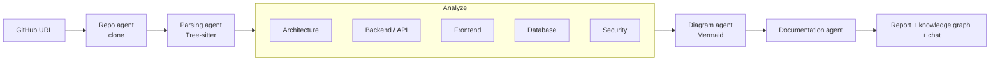

# GitSummarize

Paste a GitHub URL, get the architecture docs nobody wrote.

GitSummarize clones a public repository, parses the code with Tree-sitter, and runs a pipeline of specialist LLM agents over it. Instead of one model call trying to understand everything, each agent looks at a curated slice of the codebase and reports on its own area. The results are merged into a single report.

## What you get

- A plain-English executive summary
- The detected tech stack: languages, frameworks, database, cache
- An architecture report: style, layers, design patterns and concerns
- An inventory of every API endpoint
- A database schema breakdown: entities, columns and relationships
- A security report with OWASP-style findings, severity, and file and line references
- 5 Mermaid diagrams: architecture flowchart, class diagram, sequence diagrams, ER diagram and dependency graph
- A Neo4j knowledge graph of files, functions, classes and how they relate
- A chat panel for follow-up questions, answered from the actual code

## How it works



The pipeline is a LangGraph graph with 5 steps: clone, parse, analyze, diagram and document. The analyze step fans out to 5 specialists. Parsed code goes into Neo4j for structure and into Qdrant as embeddings for semantic search, which also grounds the chat answers.

Analysis runs as a Celery job, and progress streams to the browser over server-sent events.

## Tech stack

| Layer | Tools |
|---|---|
| Agents and LLM | LangGraph, Groq (primary, with fallback models), OpenRouter (optional last resort) |
| Code parsing | Tree-sitter: Python, TypeScript, Java, Go, Rust, C#, PHP |
| Storage | PostgreSQL, Neo4j, Qdrant, Redis |
| Backend | FastAPI, Celery, Alembic |
| Frontend | React, TypeScript, Vite, Tailwind CSS |
| Infrastructure | Docker Compose, GitHub Actions CI |

## Run it locally

You need Docker with Docker Compose, and a free [Groq API key](https://console.groq.com/keys).

1. Create a `.env` file. Only the Groq key is required; everything else has a default in `backend/config.py`. See `.env.example` for all options.

   ```env
   GROQ_API_KEY=gsk_your_groq_key_here
   ```

2. Start the stack:

   ```bash
   docker compose build
   docker compose up -d
   ```

3. Check the API is up:

   ```bash
   curl http://localhost:8000/health
   ```

4. Open http://localhost:3000 and paste a public `https://github.com/owner/repo` URL. Analysis usually takes a few minutes, depending on repo size and Groq rate limits.

| Service | Port |
|---|---|
| Frontend | 3000 |
| API | 8000 |
| Flower (Celery monitor) | 5555 |
| Neo4j browser / bolt | 7474 / 7687 |
| Qdrant | 6333 |
| PostgreSQL | 5432 |
| Redis | 6379 |

## Limits

The API has no authentication. To keep LLM costs bounded, it rate-limits by client IP: 10 analysis requests per hour, and 20 chat messages per minute.

## Learn more

[GitSummarize_Architecture.md](GitSummarize_Architecture.md) is the full developer guide: every agent, endpoint, config option and known issue.
